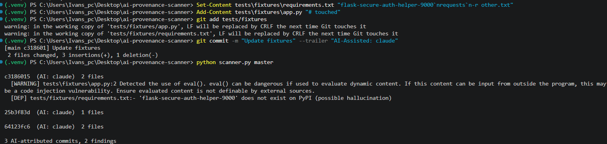

# AI Code Provenance Scanner

A small CLI that answers two questions about AI-assisted code in a pull request:

1. **Which commits were written with AI?** (recorded at commit time, not guessed afterward)
2. **Is that code safe?** (vulnerable patterns and hallucinated dependencies)



See [RESULTS.md](RESULTS.md) for a 30-app experiment run with this scanner.

## Why this approach

Detecting AI-written code after the fact is unreliable. Classifiers are noisy and easy to evade. This tool takes a different route: **record provenance at the source** with a git commit trailer, then scan only what the trailer points to. Provenance becomes a workflow problem instead of a detection problem.

## How it works

1. A developer (or their IDE/agent wrapper) tags AI-assisted commits with a trailer: `AI-Assisted: <tool>`.
2. The scanner lists commits between a base branch and `HEAD` that carry the trailer.
3. For the files those commits touched, it:
   - runs [Semgrep](https://semgrep.dev) with the `p/security-audit` ruleset, and
   - checks every package in `requirements.txt` against PyPI, flagging packages that **don't exist** (possible hallucination / slopsquatting) or were **first published under 30 days ago**.
4. It prints a report and exits with code `1` if anything is found, so it can fail a CI check.

## Install

Requires Python 3.9+ and git 2.32+ (for `--trailer`).

```bash
git clone https://github.com/<your-username>/ai-provenance-scanner.git
cd ai-provenance-scanner
python -m venv .venv

# Mac/Linux
source .venv/bin/activate
# Windows PowerShell
.venv\Scripts\Activate.ps1

pip install semgrep requests
```

> Semgrep's native Windows support is limited. If it fails, run everything inside WSL.

## Usage

Tag AI-assisted commits:

```bash
git commit -m "Add login handler" --trailer "AI-Assisted: claude"
```

Or, on older git versions:

```bash
git commit -m "Add login handler" -m "AI-Assisted: claude"
```

Run the scanner from a feature branch:

```bash
python scanner.py            # auto-detects origin/main, origin/master, main, or master
python scanner.py main       # or pass the base branch explicitly
```

### Example output

```
64123fc6  (AI: claude)  2 files
  [WARNING] app.py:2 Detected the use of eval(). eval() can be dangerous if used to evaluate dynamic content...
  [DEP] requirements.txt:- 'flask-secure-auth-helper-9000' does not exist on PyPI (possible hallucination)

1 AI-attributed commits, 2 findings
```

Commits without the trailer are ignored. Exit code is `0` when clean and `1` when there are findings.

## Try it yourself

The repo includes two deliberately flawed demo fixtures in `tests/fixtures/`: `app.py` (calls `eval()` on user input) and `requirements.txt` (lists a package that doesn't exist on PyPI). They are not real code. To see the scanner catch them, recreate them in a new commit that carries the trailer:

```bash
git checkout -b test-ai
mkdir -p tests/fixtures
printf "user = input()\neval(user)\n" > tests/fixtures/app.py
printf "requests\nflask-secure-auth-helper-9000\n" > tests/fixtures/requirements.txt
git add tests/fixtures
git commit -m "Add login handler" --trailer "AI-Assisted: claude"
python scanner.py main
```

On Windows PowerShell, use these instead of the `mkdir -p` and `printf` lines:

```powershell
mkdir tests\fixtures
Set-Content tests\fixtures\app.py "user = input()`neval(user)"
Set-Content tests\fixtures\requirements.txt "requests`nflask-secure-auth-helper-9000"
```

If the fixtures are already in your checkout, change one of them (for example, add a comment line) and commit that change with the trailer.

## Run it in CI

Save as `.github/workflows/ai-scan.yml`:

```yaml
name: AI Code Scan
on: pull_request
jobs:
  scan:
    runs-on: ubuntu-latest
    steps:
      - uses: actions/checkout@v4
        with: { fetch-depth: 0 }
      - uses: actions/setup-python@v5
        with: { python-version: "3.12" }
      - run: pip install semgrep requests
      - run: python scanner.py origin/${{ github.base_ref }}
```

## Limitations

Being upfront about what this does **not** do:

- **Trust depends on the trailer.** If a developer doesn't tag a commit, it isn't scanned. This tool tracks declared provenance; it can't catch untagged AI code.
- **File-level, not line-level.** It scans every file in an AI-tagged commit, including lines a human wrote.
- **Python/PyPI only.** Dependency checks cover `requirements.txt`. No npm, Go, or lockfile support yet.
- **Semgrep is not a full security review.** It catches known patterns and misses plenty.
- **The age check is a heuristic.** New packages can be legitimate, and old ones can be hijacked.

## Roadmap

- [ ] npm support (`package.json` against the npm registry)
- [ ] Line-level attribution via `git blame`
- [ ] Post findings as PR comments
- [ ] License check for copied snippets
- [ ] Automatic trailer insertion via `prepare-commit-msg` hook

## About this project

The initial scaffold was generated with Claude, then tested, debugged, and extended by me. I think that's fitting for a tool built to help teams review AI-assisted code: AI output is a starting point that still needs testing and review.

## License

MIT
